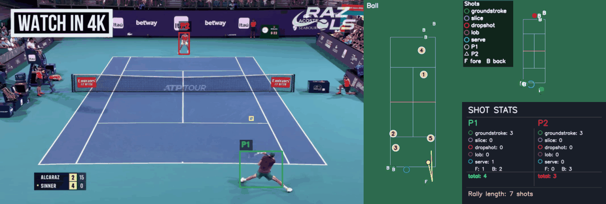
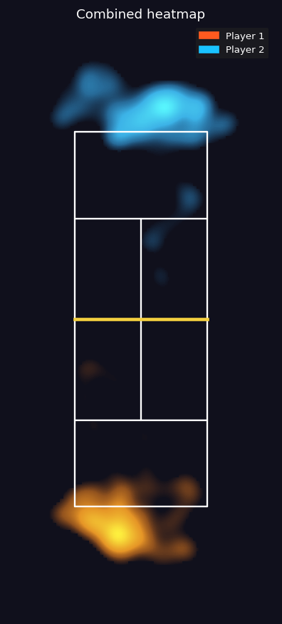
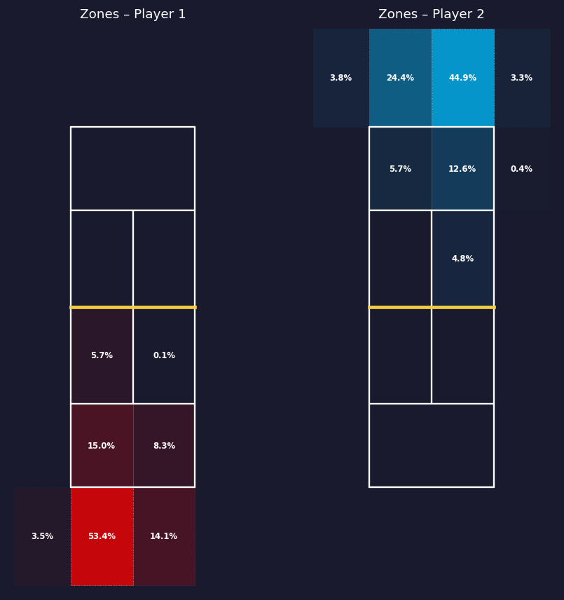
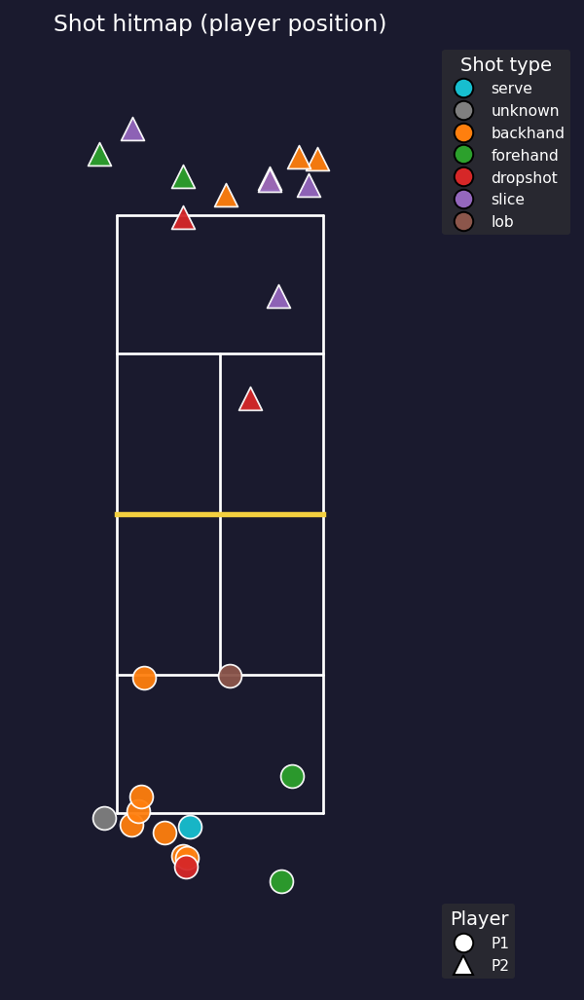
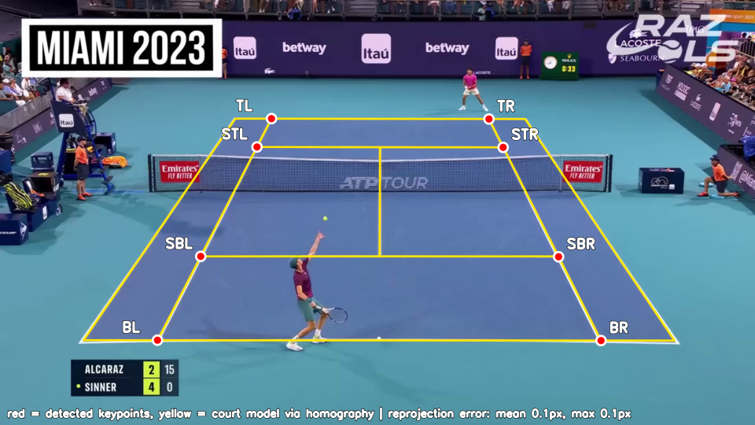
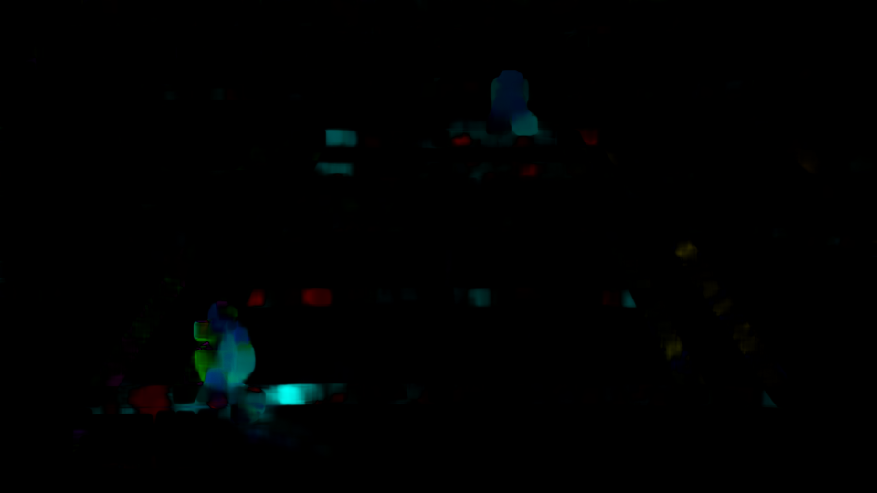
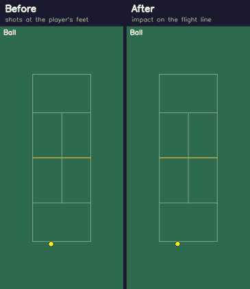
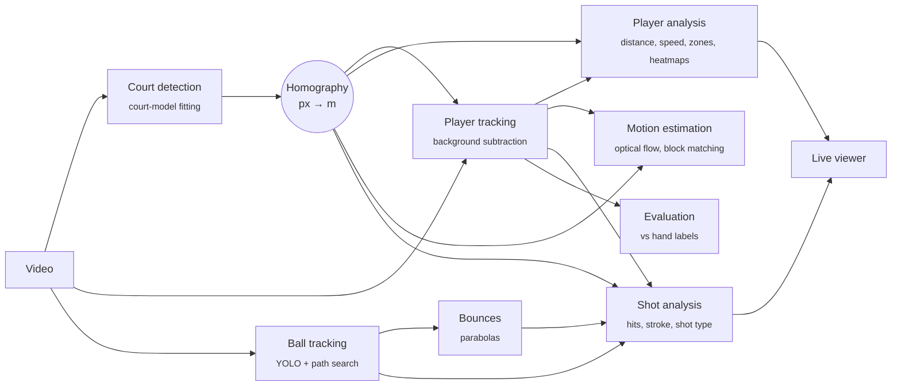
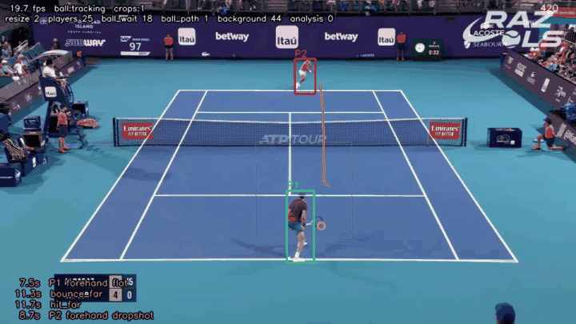

# Tennis Players Tracking

[](https://github.com/marcomassa-unitn/tennis_players_tracking/actions/workflows/ci.yml)


[](LICENSE)

**Turn a single, uncalibrated broadcast tennis clip into structured match data:**
court geometry, metric player trajectories, movement statistics, the ball track,
its bounces and a shot-by-shot breakdown (forehand/backhand, flat/slice/dropshot/lob/volley,
serve/smash), either **offline**, over the whole clip, or **in real time**, in one
pass over the frames as a camera gives them.

The core is **classical computer vision**. Court detection, player tracking, motion
estimation, bounces and shot reasoning are training-free and interpretable. The
ball is the one exception: it is small and fast, so it uses a YOLO detector, and
in real time a small one that reads the motion.

<p align="center">
  
</p>

## What's new in v2

- **A real-time pipeline** ([`realtime_pipeline.py`](realtime_pipeline.py)): court,
  players, ball, bounces and shots in one causal pass, at about 21 fps on a Kaggle
  T4 and 18–26 fps on a laptop CPU, with the same output files as the offline one.
- **A motion ball detector**: YOLO11n on 320 × 320 crops of grey + background
  differences, trained on Kaggle from the clips themselves. It finds the ball on
  81 % of the frames of 22 clips, against 75 % for the offline YOLOv8x.
- **Physical checks on the ball track**: a jump the ball cannot make at 240 km/h,
  a candidate that moves with a player (a head, a hand), something standing still
  (a TV camera's lens), a ball that went out at the top and is "found" in the
  stands are all refused.
- **Shot types from the physics of the flight**, with heights corrected for drag,
  and lobs recognised even when they fly out of the picture. Checked against **79
  hand-labelled shots on 4 clips: 67 right (85 %)**.
- **22 test clips** from hard, clay and grass courts, hand labels for the ball,
  the bounces and the shots, and a per-clip list of left-handed players.

## Highlights

- **Court reconstruction without training.** The full ITF court model,
  including the doubles alleys, is fitted to the white line markings. Each
  candidate homography is scored by how much of the *whole* court it puts on
  line pixels, so banners, net and writing next to the court are rejected. On 21
  of the 22 clips 96–99 % of the court model lands on line pixels, with the same
  settings, and the fitted lines land within about 1 px of the painted ones.
- **One homography, metric everything.** A single RANSAC homography maps pixels
  to court metres, so positions, distances, speeds (km/h) and zone occupancy are
  all physical quantities.
- **Two-player tracking that does not depend on how the clip starts.** The
  background is the median of frames spread over the clip, so a player standing
  still to serve is still detected, and fade-ins from black do not matter.
  Identities come from the court half (through the homography), so a player who
  is lost comes back as soon as they are visible again. The camera tilting or
  panning a few pixels is compensated by phase correlation. Camera shake, cast
  shadows and on-screen TV graphics are filtered out. Over the 22 clips the near
  player is found on 98 % of the frames and the far one on 99 %.
- **A ball track that obeys physics.** The ball is the best physically plausible
  path through the detector's candidates. Against hand-labelled positions on two
  clips, precision / recall are 0.98 / 0.92 and 0.98 / 0.98 in real time, with a
  centre error under 1 px, and 1.00 / 0.93 and 0.95 / 0.95 offline.
- **Bounces and shot types from the ball's physics.** Between two events the ball
  follows a parabola: where two meet gives a bounce, to within a fraction of a
  frame and 0.1–0.3 m. The flight from the contact to the bounce (landing depth,
  mean speed, apex) gives the type of each shot; serves, smashes and volleys come
  from the players' motion and the missing bounce.
- **Classical motion estimation, implemented from scratch.** Full-search and
  three-step block matching (SAD), next to Farnebäck and Lucas–Kanade optical
  flow.
- **Engineered as a pipeline.** Each pipeline runs with one command, headless,
  and stages pass data through a stable CSV contract. It ships an annotation
  tool, an evaluation against hand labels, Kaggle notebooks for the GPU work,
  181 unit tests and CI.

## Results

### Demo rally

The demo clip (`data/input2.mp4`) is 1008 frames at 30 fps, 1080p.

| Stage | Offline | Real time |
|---|---|---|
| Court | 98 % of the court model on detected line pixels; fitted lines within ≈1 px of the painted ones | same (98 %) |
| Players | both players on 100 % of the frames, identities fixed by court half | same |
| Ball, share of frames | 92 % (original single-pass detector: 60 %) | 92 % |
| Ball vs 100 hand-labelled positions | precision 1.00, recall 0.93, centre error 1.2 px | precision 0.98, recall 0.92, centre error 0.9 px |
| Bounces vs 25 hand-labelled bounces | precision 1.00, recall 0.96, median time error 0.2 frames, landing error 0.23 m | precision 0.95, recall 0.76, 0.3 frames, 0.31 m |
| Shots | 25 contacts (13 near player, 12 far player), opening serve identified | 25 contacts, opening serve identified |
| Shot type vs 23 labels | 19/23 | 21/23 |
| Movement | near player 94.8 m covered (mean 10.6 km/h, p95 29.6 km/h); far player 104.2 m (mean 11.8 km/h, p95 27.4 km/h) | |

On a second labelled clip (`input3`, 14 bounces) bounces are found with precision
and recall 1.00 in both pipelines, 0.2 frames and 0.12 m (offline) or 0.21 m (real
time) off. The synthetic self-tests pass: strokes 4/4, serve and smash 5/5 with no
false positive.

### 22 clips, real time

Kaggle T4 GPU, one run per clip with `--recalibrate` and the colour fallback,
writing the overlay video ([`notebooks/realtime_run_kaggle.ipynb`](notebooks/realtime_run_kaggle.ipynb)):

| | Mean over 22 clips (range) |
|---|---|
| Length | 16.4 s (6.8–39.9 s), 360 s in all |
| Court model on line pixels | 97 % (one clip 66 %, the others 96–99 %) |
| Near / far player found | 98 % (88–100 %) / 99 % (95–100 %) of the frames |
| Ball found | 81 % of the frames (58–98 %); offline 75 % (57–95 %) |
| Bounces, shots | 195 bounces, 256 shots |
| Speed | 20.7 fps (16.7–25.2), frame time 37 ms at the median |
| Delay | ball 0.5 s, bounces 1 s, shots 4 s |

The ball is found on 88–98 % of the frames of the first nine clips (most of them
used for training) and on 58–85 % of the thirteen newer ones, on other courts
(clay, grass, green) and with other cameras.

### Shot types against hand labels

The shots of four clips were labelled by hand
([`evaluation/annotate.py shots`](evaluation/annotate.py)): `input2` (23), `input15`,
`input19` and `input22`, 83 labels in all. A labelled shot counts when the run
finds a shot of the same player within 6 frames.

| | Shots found | Type right |
|---|---|---|
| Real time | 79 | **67 (85 %)** |
| Offline | 70 | 54 (77 %) |

The flight thresholds were chosen on the real-time tracks of the same four
clips, so the real-time figure shows how well the rules fit these labels, not an
accuracy on unseen footage. Of the 12 errors, 5 are slices called flat and the
reverse, 4 are volleys and smashes not recognised, 2 are reversals of the ball
near a player taken for shots.

| Combined position heatmap | Court-zone occupancy | Shot hitmap |
|:---:|:---:|:---:|
|  |  |  |

<p align="center">
  
  
  <br><em>Left: fitted court model (yellow) and the 8 keypoints (red). Right: dense optical flow (hue = direction, brightness = magnitude).</em>
</p>

<p align="center">
  
  <br><em>Seen from above, a bounce does not turn the ball. Left: with shots placed at the player's feet, the path bends at every bounce, by an arm and a racket. Right: with impacts placed on the flight line, it runs straight. Those impacts also tell forehand from backhand on the court.</em>
</p>

## How it works



The offline pipeline ([`pipeline.py`](pipeline.py)) runs these stages one after
the other over the whole clip; the real-time one runs them frame by frame (see
[Real time](#real-time)). Both share the court, player, bounce and shot code.

1. **Court detection** ([`tracking/court_tracking.py`](tracking/court_tracking.py)).
   Line pixels are pixels brighter than their neighbours a few pixels away,
   which keeps thin, dim lines and drops large bright areas. A Hough transform
   gives candidate lines. Every pair of horizontal and pair of oblique
   candidates, matched to the court model's lines, defines a homography. It is
   scored by projecting the whole model, doubles alleys included, onto the line
   pixels. The best hypothesis is refined by refitting every line on its own
   pixels. Several frames are tried, which handles fade-ins and occlusions.
   The run fails, rather than saving wrong keypoints, if no frame matches the
   model well enough. An overlay image is saved next to the CSV to check the
   result.
2. **Player tracking** ([`tracking/player_tracking.py`](tracking/player_tracking.py)).
   The background is the per-pixel median of about 40 frames spread over the
   whole clip, leaving out black or fade-in frames, and aligned to each other.
   Each frame is first realigned to it, because a broadcast camera can tilt or
   pan a few pixels during a clip; the shift is measured by phase correlation.
   The frame is then gain-matched and compared with the background's local
   min/max over a few pixels, so the slight shake of broadcast cameras does not
   light up the court lines. While the camera is shifted, the court lines
   themselves are masked, and thin horizontal strips are removed from blobs.
   Cast shadows are removed, and so are on-screen graphics, which stay
   pixel-identical from frame to frame. Fragments of the same person are merged,
   and blobs are kept only if their feet stand in the walkable area of the court.
   P1 is the player in the near half, P2 the one in the far half. A player seen
   recently is followed by proximity; otherwise the largest plausible blob in
   that half is taken. Gaps up to 0.5 s are interpolated and flagged in an
   `interpolated` column.
3. **Player analysis** ([`analysis/player_analysis.py`](analysis/player_analysis.py)).
   The feet point of each box is projected to metres. From it the stage computes
   distance covered, mean, median, p95 and max speed (with a physiological 45 km/h
   glitch filter), occupancy of a 6×4 zone grid over the walkable area,
   Gaussian-smoothed heatmaps and an animated top-down minimap.
4. **Motion estimation** ([`motion_estimation/`](motion_estimation)).
   Dense Farnebäck flow inside each player box is converted to km/h and compared
   with positional speed. Lucas–Kanade tracks Shi–Tomasi corners. Block matching
   is written from scratch: full search and three-step search, with
   motion-compensated PSNR against a no-motion baseline.
5. **Ball tracking** ([`tracking/ball_tracking.py`](tracking/ball_tracking.py)).
   Two stages. **Detection:** a fine-tuned YOLOv8x runs on 640 px tiles of the
   frame at native resolution, plus the whole frame. On the whole frame alone
   the ~15 px ball would shrink to ~5 px. Every candidate is kept with its
   confidence, its source and how much it moved since the previous frame.
   **Motion:** ball-sized blobs in the difference from the clip's median background
   join the candidates. They do not depend on how the ball looks, so they fill in
   where the detector does not see it, as on a court unlike its usual ones. Blobs only
   count over the court and out of a player's reach, and alone they must form a series.
   **Tracking:** still candidates (balls held by ball kids) are discarded. The
   ball is then the best path through the remaining candidates over the whole
   clip, found by dynamic programming. Confident candidates earn points, while
   links cost in proportion to the implied speed and the frames skipped, and
   impossible speeds are forbidden. Knowing the frames after a racket hit, the
   path picks the right candidate where a frame-by-frame filter would not.
   One-frame spikes are removed, and gaps up to 0.33 s are filled with a
   shape-preserving cubic and flagged. Detection needs a GPU and runs in the
   [Kaggle notebook](notebooks/ball_tracking_kaggle.ipynb). Its candidates CSV is
   reused, so tracking runs on any laptop.
6. **Bounce detection** ([`analysis/bounce_detection.py`](analysis/bounce_detection.py)).
   Between two events the ball flies freely, so in the image it follows almost a
   parabola. The real detections are split into the best sequence of parabolas by
   dynamic programming, and the point where two of them meet gives the time, between
   frames if needed, and the landing point. Physics then filters the junctions: the
   ground only pushes the ball up the image, and a bounce lies on the court, where
   the homography is exact. The order of a rally (hit, bounce on the other side,
   hit, …) picks the final labels, which is what separates a near bounce from the
   near hit that follows it.
7. **Shot analysis** ([`analysis/shot_analysis.py`](analysis/shot_analysis.py)).
   - **Contacts.** Persistent reversals of the vertical velocity and acceleration
     peaks of the ball, kept only when the ball is near a player. A contact on a
     bounce of the striker's own side moves to the hit after it, and a contact must
     send the ball towards the opponent.
   - **The players alternate.** Two shots of one player less than 0.6 s apart are
     one contact counted twice. Further apart, the opponent's shot in between was
     missed and is added, from the events or from where the ball turned back,
     but only if the ball went to the opponent: seen on their side or within their
     reach, or out of sight long enough to go there and back. Otherwise the ball
     never left the player (a lob they run after, a bounce out of sight), and only
     their later shot is kept.
   - **Serve.** The opening shot of a point: the first after a quiet spell, by a
     player standing still on their baseline, with the arm and racket raised. It
     needs no ball, often not seen at the far end.
   - **Smash.** The same raised arm inside the court, with the ball seen coming
     down from above the player in the second before. A hit the ball shows close
     by wins over it.
   - **Forehand or backhand.** Seen from above a bounce does not turn the ball, so
     the previous impact, the bounce and the next impact lie on one line: the impact
     is taken on that line, an arm and a racket from the feet, and its side gives
     the stroke. The dominant hands come from
     [`ground_truth/hands.csv`](ground_truth/hands.csv) (right if not listed) or
     `--p1-hand` / `--p2-hand`.
   - **Type, from the flight to the bounce.** The height of the ball is its
     distance in the image from the point below it on the court; that point moves
     from the impact to the landing point slowing down as the ball does
     (exp(−t)), which keeps the heights the same at both ends of the court.
     A shot is a **dropshot** if it lands within 4.5 m of the net at a mean ground
     speed of 20 m/s at most. Otherwise a ball at 21 m/s at most is never flat:
     a **lob** if it flies at 2.5 m or higher, else a **slice**. The faster ones
     are **flat**.
   - **Taken in the air** (no bounce before the reply): a lob if the flight lasts
     over 1.05 s, rises by 1 m and goes above 3 m. A **volley** is a shot played
     from inside the court with no bounce since the opponent's shot, the ball
     coming and going back.
   - **A lob out of sight.** A lob often leaves the picture or flies against the
     crowd. Around the contact the ball goes up the picture, already above the
     far striker's head (or above the far baseline for the near striker), then
     nothing is seen for 0.4 s, and the reply comes after 1.05 s.

The [**live viewer**](live_view.py) replays the clip with player and ball boxes,
a synced minimap, a running shot tally and a court following the ball, with its
bounces numbered as they happen. The ball moves there on its path over the ground,
from each contact to each bounce, since an airborne ball cannot be projected. At
the end it shows the whole-clip heatmap, zones, shot hitmap and bounces.

## Real time

<p align="center">
  
  <br><em>The real-time overlay of the demo rally: timings per stage (top), the crop read by the ball detector, the ball trail, and bounces and shots as they are committed.</em>
</p>

[`realtime_pipeline.py`](realtime_pipeline.py) runs the whole analysis in **one
causal pass**: each frame is seen once, in order, as a camera would give it. A
thread decodes the video, one loop processes the frames, and the slow jobs run in
worker threads. It writes the same files as the offline pipeline, under
`outputs/realtime/<clip>/`, so `live_view.py --realtime` shows them and the
evaluation reads them unchanged.

**Startup.** With a fixed camera, the court and the empty court can be learnt
before the match, during the warm-up for instance. `--calibrate` does it once per
clip and saves `court.csv`, `court.png` and `background.png` in
`outputs/realtime/<clip>/calibration/` (`--recalibrate` computes them again). The
background is the median of 41 frames spread over the clip, at full resolution,
and the analysis tracks from the first frame. Without calibration, the court is
fitted on the first frames and the background learnt in the first 2 s, which go
untracked. `--court` and `--background` take known ones.

**Per frame.**

1. **Players**: the offline tracker, frame by frame, against the background of
   the moment ([`utils/background.py`](utils/background.py)): a ring of samples,
   one per second, refreshed every 5 s in a worker thread, with the players
   masked out so a server standing still does not become background.
2. **Ball**: a detector reads crops of the frame, and a path search with a fixed
   lag picks the ball among its candidates (below).
3. **Bounces and shots**: the offline functions run every second on the last 10 s
   in a worker thread. A bounce is committed once it is 1 s old, a shot once it is
   4 s old.
4. **Overlay** (`--display`, `--video-out`): boxes, ball trail, events, and the
   time each stage takes.

At the end `realtime/summary.json` and `timings.csv` give the frame rate, the time
of every stage and the counters of the ball tracker.

**The ball detector** ([`tracking/ball_online.py`](tracking/ball_online.py),
[`tracking/ball_model.py`](tracking/ball_model.py)). YOLO11n reads 320 × 320 crops
at full resolution, with three channels: grey, difference from the background at
*t*, the same at *t − 1*. The difference shows the ball whatever the colour of the
court; the grey image tells it from a racket.

- While the ball is followed, a Kalman filter predicts it and **one crop** is read
  there, up to the top of the picture. Above the court only a detection where the
  ball is expected is accepted: the crowd and the boards are behind it there.
- When it is lost, the crops cover the court (`--search tiles`, the GPU default)
  or the moving blobs (`--search blobs`, every other frame, the CPU default).
- A ball lost at the top is looked for where it left for 3 s, and the search keeps
  to a corridor around there, moved on at its sideways speed: above the picture
  nothing hits it, and a ball in flight never turns back sideways (a spectator in
  the stands was taken for it otherwise).
- **Colour fallback** (`--fallback models/ball_tracker.pt`, for a GPU). The
  offline YOLOv8x reads one crop of the plain frame when the ball is expected
  inside a player's box, where the difference shows the player too: about one
  frame in twenty.
- Short gaps by a player get a second look with a lower threshold (`--no-refill`
  turns it off).

**The path search** ([`tracking/ball_tracking.py`](tracking/ball_tracking.py),
[`tracking/ball_reach.py`](tracking/ball_reach.py)) is the offline one with a
fixed lag of 16 frames (0.5 s), and checks that the ball can do what the path says:

- **Every jump is physically possible.** One camera does not see how high the
  ball is, so each pixel is a set of points along the camera ray. A move is
  allowed if it carries on the ball's motion, if it is at most 240 km/h (the
  fastest serves) along the ground, or if a racket of a player the ball was on can
  reach it at that speed: after a hit the ball may go anywhere it can reach.
- **What moves with a player is part of them.** A candidate that keeps its place
  in a player's box for 3 frames is a head, a hand or a wristband.
- **Nothing standing still is the ball.** Away from the players, a candidate
  with another within 6 px of it in 13 of the 15 frames before is dropped (at the
  top of a vertical rise gravity keeps a ball within 6 px for 12 frames at most).
  The spot is remembered for 10 s. This removed a TV camera's lens, a spectator
  and a ball kid's head, each taken for the ball several times.
- Still detections never start or keep a track (a ball kid holding a ball).

**The detector's training** ([`notebooks/ball_motion_training_kaggle.ipynb`](notebooks/ball_motion_training_kaggle.ipynb)).
[`training/build_ball_dataset.py`](training/build_ball_dataset.py) replays the
clips with the online background and cuts the crops: positives from the reliable
detections of the offline tracker and from hand labels where it misses
(`python evaluation/annotate.py ball --frames-from <ball CSV>`), extra crops next
to the players and above the court, and negatives where the ball is known to be
elsewhere. `input1`, `input2` and `input11` are held out for testing.
[`training/pack_kaggle_inputs.py`](training/pack_kaggle_inputs.py) zips the CSVs
to upload next to the videos; [`training/export_ball_model.py`](training/export_ball_model.py)
exports the weights to ONNX (and TensorRT on the GPU).
[`evaluation/benchmark_ball.py`](evaluation/benchmark_ball.py) scores every track
against the hand labels, and the detector alone on crops around the true ball.

**Speed.**

| | input2 (34 s) | input1 (7 s) |
|---|---|---|
| Kaggle T4, PyTorch FP16, tiles + colour fallback, overlay video | 20.9 fps | 25.2 fps |
| Laptop CPU (i5-1135G7, on battery), onnxruntime, blobs | 18.2 fps | 26.4 fps |

On the T4, players take 27 ms per frame and the ball 37 ms, side by side; on
the CPU 44 and 39 ms. What costs most is the search over the court tiles while
the ball is lost, and the colour fallback. The video runs at 30 fps, so the
pipeline keeps up with about two thirds of it; with `--clock live` it drops the
frames it has no time for, like a camera.

## Quick start

```bash
git clone https://github.com/marcomassa-unitn/tennis_players_tracking.git
cd tennis_players_tracking
python -m venv .venv && source .venv/bin/activate   # Windows: .venv\Scripts\activate
pip install -r requirements.txt
```

**Models.** They are not in the repository: download them from the
[latest release](https://github.com/marcomassa-unitn/tennis_players_tracking/releases/latest)
into `models/`.

| File | Used by |
|---|---|
| `ball_tracker.pt` | offline ball detection (YOLOv8x) and the real-time colour fallback |
| `ball_motion.onnx` | real-time ball detector on a CPU (onnxruntime) |
| `ball_motion.pt` | real-time ball detector on a NVIDIA GPU (PyTorch) |

**Offline.** Run the whole pipeline on the demo clip. It's headless and writes
everything to the clip's own folder, `outputs/input2/`:

```bash
pip install ultralytics          # only to detect the ball here, best on a GPU
python pipeline.py --video data/input2.mp4
python live_view.py --video data/input2.mp4      # space: pause, n: next frame, q: quit
```

It lists which steps already have results and asks which ones to redo; the rest
is reused. Redoing a step also offers to redo the steps that read its results.
Without a terminal, only the missing steps run. Ball detection is heavy: without a
GPU, run [`notebooks/ball_tracking_kaggle.ipynb`](notebooks/ball_tracking_kaggle.ipynb)
on Kaggle and put the resulting `ball_candidates_<clip>.csv` in
`outputs/<clip>/ball_coordinates/`. Without the model or the CSV, ball tracking
and shot analysis are skipped cleanly and the other stages still run.

**Real time.**

```bash
pip install -r requirements-realtime.txt
python realtime_pipeline.py --video data/input2.mp4 --calibrate                 # CPU, ONNX model
python realtime_pipeline.py --video data/input2.mp4 --calibrate \
    --model models/ball_motion.pt --fallback models/ball_tracker.pt              # NVIDIA GPU
python realtime_pipeline.py --video data/input2.mp4 --calibrate --clock live --display   # like a camera
python live_view.py --video data/input2.mp4 --realtime                          # watch the result
```

On a GPU, install a CUDA build of PyTorch and `ultralytics` first (see
[`requirements-realtime.txt`](requirements-realtime.txt)); the console line
`ball model: ... [torch, GPU]` confirms it is used. `--model diff` runs with no
model at all, on the background difference only. The runs of the tables above
used [`notebooks/realtime_run_kaggle.ipynb`](notebooks/realtime_run_kaggle.ipynb).

To use your own clip, put it in `data/` and change `--video`: every output is
named after the video. If a player is left-handed, add a line to
[`ground_truth/hands.csv`](ground_truth/hands.csv).

<details>
<summary><b>Running individual stages</b></summary>

```bash
# 1. Tracking: produces the CSVs everything else reads
python tracking/court_tracking.py  --video data/input2.mp4 --no-display
python tracking/player_tracking.py --video data/input2.mp4 --no-display
python display_player_tracking.py  --video data/input2.mp4   # watch the tracker's stages (saves nothing)
python tracking/ball_tracking.py   --video data/input2.mp4 --detect-only   # GPU: YOLO candidates
python tracking/ball_tracking.py   --video data/input2.mp4 \
    --candidates outputs/input2/ball_coordinates/ball_candidates_input2.csv     # CPU: tracking

# Check the court keypoints: draws them and the reprojected court model on a frame
# (court_tracking.py also saves this image next to the court CSV)
python utils/court_overlay.py --video data/input2.mp4

# 2. Analysis
python analysis/player_analysis.py  --video data/input2.mp4 [--no-animation]
python analysis/bounce_detection.py --video data/input2.mp4
python analysis/shot_analysis.py    --video data/input2.mp4    # hands from ground_truth/hands.csv

# 3. Motion estimation
python motion_estimation/optical_flow.py   --frames 200
python motion_estimation/block_matching.py --method both

# 4. Hand labels and evaluation
python evaluation/annotate.py boxes  --video data/input2.mp4 --step 30
python evaluation/annotate.py court  --video data/input2.mp4
python evaluation/annotate.py ball   --video data/input2.mp4 --step 10   # click the ball, n = not visible
python evaluation/annotate.py bounce --video data/input2.mp4   # a/d move, click + ENTER = bounce, h = hidden
python evaluation/annotate.py shots  --video data/input2.mp4   # label the shots of a run, one key per type
python evaluation/evaluate_tracking.py --ball-gt ground_truth/ball_input2_gt.csv \
    --ball-pred outputs/input2/ball_coordinates/ball_input2.csv
python evaluation/evaluate_tracking.py --video data/input2.mp4 --bounce-gt ground_truth/bounce_input2_gt.csv \
    --bounce-pred outputs/input2/shot_analysis/bounces.csv --court outputs/input2/court_coordinates/input2_court.csv
python evaluation/evaluate_shot_types.py                       # real-time shots vs the labels
python evaluation/evaluate_shot_types.py --results outputs     # offline shots
```

Useful `pipeline.py` flags:

- `--display` shows the OpenCV windows.
- `--redo 2,6`, `--redo shots`, `--redo all`, `--redo missing` choose the steps
  to redo without asking.
- `--skip-court`, `--skip-tracking`, … skip single steps, also without asking.
- `--flow-frames N` caps the dense optical flow at N frames.
- `--gt-csv` / `--court-gt-csv` enable the evaluation stage.

Every script supports `--help`. The shot analysis has built-in self-tests:

```bash
python analysis/shot_analysis.py --self-test           # synthetic strokes
python analysis/shot_analysis.py --overhead-self-test  # synthetic serve/smash
python analysis/shot_analysis.py --type-self-test      # labelled demo rally (needs the offline outputs)
```

</details>

## Project structure

```
├── pipeline.py              # offline: one-command runner for all stages
├── realtime_pipeline.py     # real time: the same analysis in one causal pass
├── live_view.py             # replay with overlays, minimap and live stats
├── display_player_tracking.py  # player tracker's stages side by side, for inspection
├── tracking/                # court, players, offline YOLO ball tracker, motion ball detector,
│                            # online ball tracker, physical checks of the ball's jumps
├── realtime/                # frame source, calibration, the per-frame loop, overlay, timings
├── analysis/                # player statistics, bounces, shots (offline and on a sliding window)
├── training/                # dataset, training and export of the motion ball detector
├── motion_estimation/       # Farnebäck / Lucas–Kanade, block matching from scratch
├── evaluation/              # annotation tool, tracking metrics, shot types vs labels, ball benchmark
├── ground_truth/            # hand labels: ball, bounces, shots; hands.csv (left-handed players)
├── utils/                   # court geometry (ITF), homography, online background, paths, video
├── tests/                   # pytest suite (run in CI)
├── notebooks/               # Kaggle GPU notebooks: ball detection, offline and real-time runs, training
├── data/                    # demo clip
├── models/                  # the weights from the release (not in git)
└── outputs/<clip>/          # offline results of a clip; outputs/realtime/<clip>/ real-time ones (not in git)
```

## Development

```bash
pip install -r requirements-dev.txt
pytest          # unit tests: homography, block matching, IoU, ball tracking, shots, …
ruff check .    # lint
```

## Limitations

- **Fixed camera assumed.** Small tilts and pans are compensated, but replays and
  camera cuts must be trimmed beforehand, and the court is fitted once.
- **Real time is not yet at video rate.** About 21 fps on a T4 for 30 fps video:
  the court-tile search while the ball is lost and the colour fallback cost the
  most. Bounces are known 1 s after they happen, shots 4 s after.
- **Players stay in their half.** Identities come from the court half, which
  holds in singles play; a player crossing the net (rare) would swap IDs.
- **Player positions are noisy.** They come from the bottom edge of the box, which
  moves with shadows, raised feet and jumps. At the far end one pixel spans about 8 cm of
  court, so the far player's dot jumps on the minimap, and distances, summed frame by
  frame, come out too long.
- **Heights and speeds come from one camera.** The homography models the ground;
  the ball's height is estimated from the path below it, and the metre-based
  thresholds may need retuning for a different camera.
- **The ball is harder to see on some courts.** It is found on 88–98 % of the
  frames of the first nine clips, mostly used for training, and on 58–85 % of the
  newer ones (clay, grass, green courts, other cameras): there fewer flights and
  bounces are measured, and more shots rely on the trajectory shape alone.
- **Shots need the ball.** When the ball is lost around a contact, the shot is placed
  where it comes back, sometimes 20 frames late, and its type suffers. A shot with no
  trace of the ball is missed, and a reversal near a player can pass for a shot.
- **Serves and smashes need the striker in view.** A serve hit during a fade-in, or
  before the server's box is tracked, is not detected. A clip starting during a rally
  with a player standing on the baseline can open with a false serve.
- **Some bounces cannot be seen.** When the ball passes behind a player around
  the landing, or the track has a gap there, no bounce is reported. The landing
  error reaches about 1 m at the far end, so this is no line-calling tool.
- **Shot labels cover four clips.** The flight thresholds were chosen on them; slices
  and flat shots are the most confused types, and volleys and smashes the least
  checked.
- **Handedness is not detected.** Left-handed players must be listed in
  `ground_truth/hands.csv`.

## Future work

- **Better bounce detection: the weakest part today.** A bounce is the corner
  between two parabolas of the ball's path in the image, so it is missed when the
  ball passes behind a player or the track has a gap around the landing, a bounce
  and a hit near a player are confused, and the end of a point (ball into the net, picked
  up, bounced before the next serve) produces bounces that never happened. Since
  the shot types read the flight up to the bounce, every missed or wrong bounce
  also costs a shot type. Next steps: more bounce labels (only `input2` and
  `input3` have them), a learned classifier on a short window of the ball's
  positions and speeds instead of the hand-set corner rules, and a check against
  the order of the rally (one bounce on the receiver's side between two shots).
- **Better ball tracking.** The ball is found on 88–98 % of the frames of the first
  clips but only on 58–85 % of the newer ones (clay, grass, green courts, other
  cameras), and every gap weakens bounces and shots. The motion detector's labels
  are mostly the offline tracker's own detections, so it starts from what that
  tracker already finds; the frames it misses (green courts, fast flights) need
  labels by hand, which `annotate.py ball --frames-from` offers one after the other.
  A temporal model on several consecutive frames, as TrackNet does, is the next step.
- **Faster search for a lost ball.** Fewer tiles, chosen from where the ball can
  be, would bring the real-time pipeline to video rate on a mid-range GPU.
- **Smooth the player positions.** A median and a low-order filter over the clip remove
  almost all the impossible jumps with no delay, and would correct distances and speeds.

## Authors

Developed by **Marco Massa**, **Alfonso Antognozzi** and **Davide Cabitza** as
the project for the *Signal, Image and Video* course at the University of Trento.

Released under the [MIT License](LICENSE). The demo footage is included for
academic use only; see [`data/README.md`](data/README.md).
