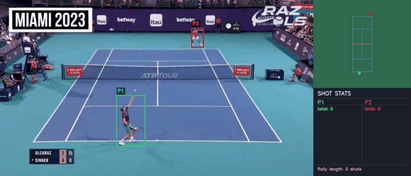
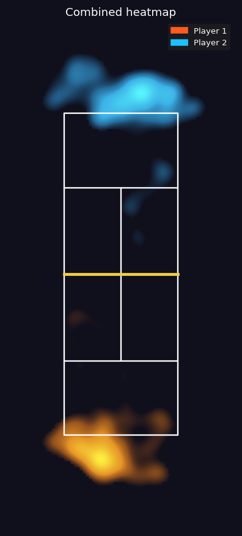
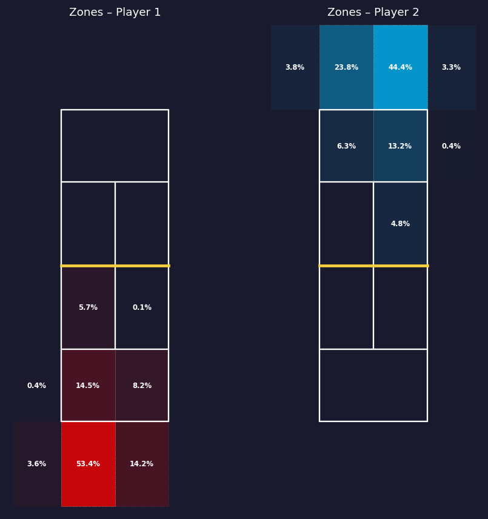
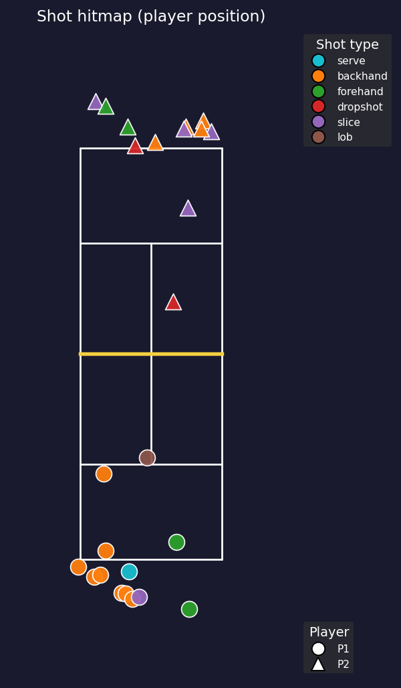
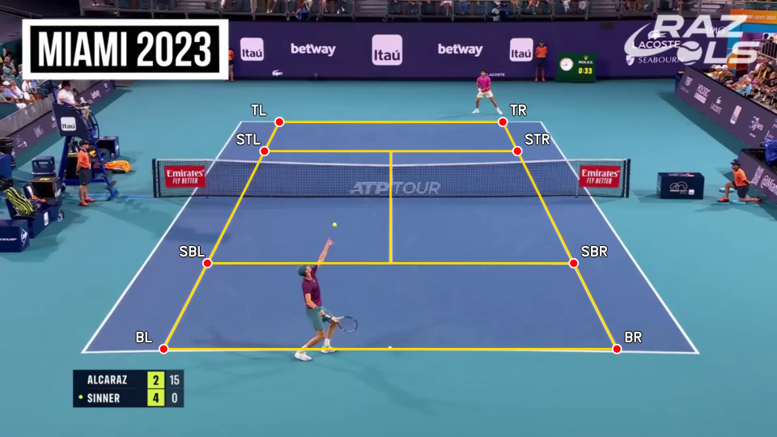
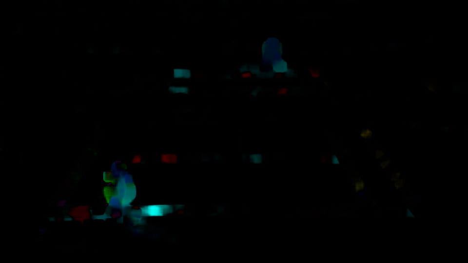
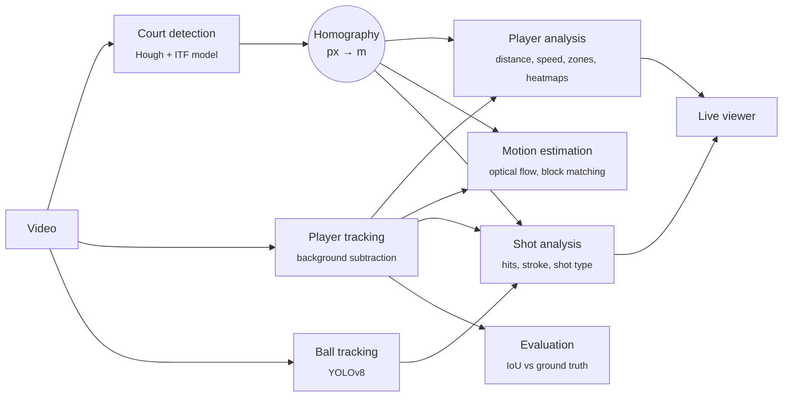

# Tennis Players Tracking

[](https://github.com/marcomassa-unitn/tennis_players_tracking/actions/workflows/ci.yml)


[](LICENSE)

**Turn a single, uncalibrated broadcast tennis clip into structured match data:**
court geometry, metric player trajectories, movement statistics, the ball track
and a shot-by-shot breakdown (forehand/backhand, flat/slice/dropshot/lob,
serve/smash).

The core is **classical computer vision**. Court detection, player tracking, motion
estimation and shot reasoning are training-free and interpretable. The ball is
the one exception: it is small and fast, so it uses a YOLOv8 detector.

<p align="center">
  
</p>

## Highlights

- **Court reconstruction without training.** Eight labelled keypoints come from
  the white line markings (HSV mask, Canny, probabilistic Hough, intersection
  clustering). The thin, washed-out far baseline is recovered with a
  *projective-consistency* test against the ITF court model. Line-fit residuals
  are about 1 px.
- **One homography, metric everything.** A single RANSAC homography maps pixels
  to court metres, so positions, distances, speeds (km/h) and zone occupancy are
  all physical quantities.
- **Two-player tracking with stable identities.** A running-average background
  model plus connected components, with minimum-cost association so the players
  keep their IDs through net crossings.
- **Perspective-invariant shot classification.** Shot types are read from
  scale-free trajectory-shape features, so near-side and far-side shots need no
  separate calibration. It labels all 23 shots of a hand-labelled rally
  correctly (flat, slice, dropshot, lob).
  Every contact is also classified as forehand or backhand.
- **Classical motion estimation, implemented from scratch.** Full-search and
  three-step block matching (SAD), next to Farnebäck and Lucas–Kanade optical
  flow.
- **Engineered as a pipeline.** It runs with one command, headless, and each
  stage is isolated so one failure doesn't stop the rest. Stages pass data
  through a stable CSV contract. It also ships an annotation tool, IoU-based
  evaluation against manual ground truth, unit tests and CI.

## Results on the demo rally

The demo clip (`data/Input_video2.mp4`) is 1008 frames at 30 fps, 1080p. On it
the pipeline produces:

| Stage | Result |
|---|---|
| Court | 8 keypoints, homography with ≈1 px line-fit residuals |
| Players | both players tracked over the whole clip, identities kept through net crossings |
| Movement | near player 82.0 m covered (mean 9.2 km/h, p95 24.9 km/h); far player 97.6 m (mean 11.1 km/h, p95 29.5 km/h) |
| Shots | 25 contacts detected (13 near player, 12 far player), opening serve identified as a serve |
| Shot mix | 17 flat, 5 slice, 2 dropshot, 1 lob; 18 backhands, 6 forehands |
| Shot type | **23/23** against a hand-labelled ground truth (`--type-self-test`)¹ |
| Self-tests | synthetic stroke test 4/4, synthetic serve/smash test 4/4 with zero false positives |

¹ The shot-type thresholds were tuned on this same rally, so 23/23 shows the
rules fit the labelled data. It is not an accuracy figure on unseen footage.
The report's 21/23 refers to an earlier version of the classifier.

| Combined position heatmap | Court-zone occupancy | Shot hitmap |
|:---:|:---:|:---:|
|  |  |  |

<p align="center">
  
  
  <br><em>Left: detected court keypoints. Right: dense optical flow (hue = direction, brightness = magnitude).</em>
</p>

## How it works



1. **Court detection** ([`tracking/court_tracking.py`](tracking/court_tracking.py)).
   An HSV white mask, morphology, Canny and probabilistic Hough find the court
   lines. Pairwise line intersections are clustered, and doubles-alley corners
   are removed using ITF proportions. The far baseline and service line are
   found with a 1-D white-coverage profile between the fitted sidelines. The
   candidate pair is chosen by projective consistency with the court model,
   which rejects banners and the net band.
2. **Player tracking** ([`tracking/player_tracking.py`](tracking/player_tracking.py)).
   A running-average background model (`cv2.accumulateWeighted`) is thresholded
   and cleaned with morphology, then split into connected components. Players
   are associated frame to frame by a 2×2 minimum-cost assignment with a
   maximum-displacement gate, so identities survive the players crossing paths.
3. **Player analysis** ([`analysis/player_analysis.py`](analysis/player_analysis.py)).
   The feet point of each box is projected to metres. From it the stage computes
   distance covered, mean, median, p95 and max speed (with a physiological 45 km/h
   glitch filter), occupancy of a 6×4 zone grid over the walkable area,
   Gaussian-smoothed heatmaps and an animated top-down minimap.
4. **Motion estimation** ([`motion_estimation/`](motion_estimation)).
   Dense Farnebäck flow inside each player box is converted to km/h and compared
   with positional speed. Lucas–Kanade tracks Shi–Tomasi corners. Block matching
   is written from scratch: full search and three-step search, with
   motion-compensated PSNR against a no-motion baseline.
5. **Ball tracking** ([`tracking/ball_tracking.py`](tracking/ball_tracking.py)).
   A YOLOv8 detector (confidence 0.65) is gated by a frame-difference motion
   check. Short gaps are interpolated and flagged as such.
6. **Shot analysis** ([`analysis/shot_analysis.py`](analysis/shot_analysis.py)).
   Contacts are detected from persistent reversals of the vertical velocity and
   from acceleration peaks on the Savitzky–Golay-smoothed ball track, and are
   kept only when the ball is near a player. That rejects bounces. The stroke
   (forehand/backhand) comes from the ball's side relative to the body axis,
   taking handedness and court side into account. The shot type comes from
   perspective-invariant features of the outgoing trajectory. Serve and smash go
   in a separate, conservative overhead column.
7. **Evaluation** ([`evaluation/`](evaluation)). A small OpenCV tool annotates
   ground-truth boxes and court keypoints. The evaluator reports mean and median
   IoU, precision and recall at IoU 0.5, centre error (px), feet error (m), ID
   switches and per-keypoint court error.

The [**live viewer**](live_view.py) replays the clip with player and ball boxes,
a synced minimap and a running shot tally. At the end it shows the whole-clip
heatmap, zones and shot hitmap.

## Quick start

```bash
git clone https://github.com/marcomassa-unitn/tennis_players_tracking.git
cd tennis_players_tracking
python -m venv .venv && source .venv/bin/activate   # Windows: .venv\Scripts\activate
pip install -r requirements.txt
```

**Optional: ball tracking.** Install the detector dependency and download the
trained weights from the
[latest release](https://github.com/marcomassa-unitn/tennis_players_tracking/releases/latest)
into `models/ball_tracker.pt`:

```bash
pip install ultralytics
```

Run the whole pipeline on the demo clip. It's headless and writes everything to
`outputs/`:

```bash
python pipeline.py --video data/Input_video2.mp4
```

Then watch the result:

```bash
python live_view.py --video data/Input_video2.mp4      # press q to quit
```

If the weights are missing, ball tracking and shot analysis are skipped cleanly
and the other stages still run. To use your own clip, put it in `data/` and
change `--video`. Every intermediate file is named after the video, so no other
paths need editing.

<details>
<summary><b>Running individual stages</b></summary>

```bash
# 1. Tracking: produces the CSVs everything else reads
python tracking/court_tracking.py  --video data/Input_video2.mp4 --no-display
python tracking/player_tracking.py --video data/Input_video2.mp4 --no-display
python tracking/ball_tracking.py   --video data/Input_video2.mp4 --no-display --no-video

# 2. Analysis
python analysis/player_analysis.py --video data/Input_video2.mp4 [--no-animation]
python analysis/shot_analysis.py   --video data/Input_video2.mp4 --p1-hand right --p2-hand right

# 3. Motion estimation
python motion_estimation/optical_flow.py   --frames 200
python motion_estimation/block_matching.py --method both

# 4. Ground truth and evaluation
python evaluation/annotate.py boxes --video data/Input_video2.mp4 --step 30
python evaluation/annotate.py court --video data/Input_video2.mp4
python evaluation/evaluate_tracking.py --gt <gt_boxes.csv> \
    --pred outputs/player_coordinates/players_Input_video2.csv \
    --court outputs/court_coordinates/Input_video2_court.csv \
    --court-gt <gt_court.csv>
```

Useful `pipeline.py` flags:

- `--display` shows the OpenCV windows.
- `--skip-court`, `--skip-tracking`, … reuse CSVs that are already on disk.
- `--flow-frames N` caps the dense optical flow at N frames.
- `--gt-csv` / `--court-gt-csv` enable the evaluation stage.

Every script supports `--help`.

The shot-type thresholds are exposed as CLI flags (`--far-peak-m`,
`--drop-diefrac`, `--lob-pace`, …) and can be checked with the built-in
self-tests:

```bash
python analysis/shot_analysis.py --self-test           # synthetic strokes
python analysis/shot_analysis.py --overhead-self-test  # synthetic serve/smash
python analysis/shot_analysis.py --type-self-test      # labelled demo rally (needs the ball CSV)
```

</details>

## Project structure

```
├── pipeline.py              # one-command runner for all stages
├── live_view.py             # replay with overlays, minimap and live stats
├── tracking/                # court keypoints, player tracker, YOLO ball tracker
├── analysis/                # player statistics and shot detection/classification
├── motion_estimation/       # Farnebäck / Lucas–Kanade, block matching from scratch
├── evaluation/              # annotation tool and tracking metrics
├── utils/                   # court geometry (ITF), pixel→metre homography, video helpers
├── tests/                   # pytest suite (run in CI)
├── notebooks/               # Colab notebook to run ball detection on a GPU
├── docs/                    # report (PDF + LaTeX) and presentation
├── data/                    # demo clip
└── models/                  # put ball_tracker.pt here
```

## Development

```bash
pip install -r requirements-dev.txt
pytest          # unit tests: homography, block matching, IoU, shot self-tests, …
ruff check .    # lint
```

## Limitations

- **Static camera assumed.** Replays and camera cuts must be trimmed beforehand.
- **Identity by proximity only.** The tracker has no appearance model, so long
  occlusions can still swap IDs. The evaluation measures this as ID switches.
- **Ball speeds are approximate.** The homography models the ground plane, while
  the ball is airborne at contact. The metre-based shot thresholds may need
  retuning for a different camera; the scale-free ones do not.
- **Thresholds are tuned on one camera setup.** The shot-type defaults were fit
  on the demo rally.

## Report and presentation

The [academic report](docs/report.pdf) covers the methodology, related work and
results in detail. There is also an [HTML presentation](docs/presentation.html)
(download it and open it in a browser).

## Authors

Developed by **Marco Massa**, **Alfonso Antognozzi** and **Davide Cabitza** as
the project for the *Signal, Image and Video* course at the University of Trento.

Released under the [MIT License](LICENSE). The demo footage is included for
academic use only; see [`data/README.md`](data/README.md).
